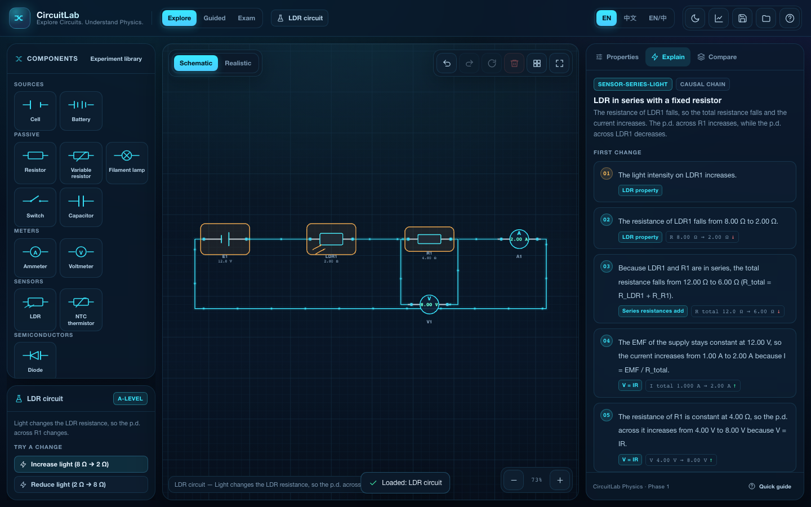

# CircuitLab A-Level

**CircuitLab Physics — Explore Circuits. Understand Physics.**
A-Level 交互式电路实验室

An interactive, browser-based circuit laboratory for IGCSE, A-Level and
International A-Level physics. Students build circuits from standard symbols or
realistic apparatus, change a physical quantity (light, temperature, resistance,
EMF) and receive a **verified causal explanation** generated from the solved
circuit — not from keyword matching.

- **Live site:** https://michaelee125.github.io/circuitlab-alevel/
- **Repository:** https://github.com/Michaelee125/circuitlab-alevel
- **Languages:** English · 简体中文 · Bilingual
- **Theme:** dark by default, light theme included
- **No backend:** the whole simulation runs in the browser and is deployed as a
  static GitHub Pages site.



## Why this is not just an animation

The core of the product is a physics reasoning engine:

1. The student changes one parameter (for example the light falling on an LDR).
2. The circuit is re-solved with **Modified Nodal Analysis** (Newton iteration
   for non-linear elements).
3. Structural predicates check what is actually connected in series or in
   parallel — meters are made "invisible" so an ammeter does not break the
   series test.
4. A rule with explicit preconditions builds a causal chain.
5. **Every predicted direction is verified against the new solution.** If a
   step does not match the numbers, the engine refuses to explain the circuit
   rather than inventing a story.

The LDR series and LDR parallel cases therefore produce genuinely different
answers: in series the p.d. across the fixed resistor rises; in parallel it
stays at the supply voltage and only the LDR branch current changes.

## Features (Phase 1)

| Area | Status |
| --- | --- |
| Free circuit editor (add, drag, rotate, delete, orthogonal wires, snap, zoom/pan, undo/redo, auto-arrange) | ✅ |
| 12 components: cell, battery, resistor, variable resistor, filament lamp, switch, ammeter, voltmeter, LDR, NTC thermistor, capacitor, diode | ✅ |
| Schematic and realistic rendering, same model and results | ✅ |
| MNA DC solver with internal resistance, ideal meters, open/short/singular handling | ✅ |
| Non-linear lamp and diode models, RC analytic transients | ✅ |
| Physics reasoning engine (English + Chinese, marking points, exam-style answer) | ✅ |
| Explore / Guided / Exam modes, before/after Compare | ✅ |
| 11 runnable experiments (the 10 required templates + the LDR parallel case) | ✅ |
| Charts: I–V, V–I with linear fit, V–t / I–t, CSV export | ✅ |
| Save/load (IndexedDB), JSON import/export, share link | ✅ |
| Responsive desktop / tablet / phone layout with touch wiring and pinch zoom | ✅ |
| GitHub Actions + GitHub Pages deployment | ✅ |
| WeChat mini-program adapter layer and integration plan | ✅ (Phase 2 not published) |

**Not claimed:** official mark schemes. Exam mode uses CircuitLab's own
software-authored practice marking points, clearly labelled in the UI and in
this repository.

## Quick start

```bash
# Node 20+ and pnpm 11 are required
pnpm install
pnpm dev          # http://localhost:5173
```

Useful commands:

```bash
pnpm typecheck    # strict TypeScript check of every package
pnpm test         # 47 unit / physics / reasoning tests (Vitest)
pnpm build        # production build of apps/web
pnpm preview      # preview the production build
pnpm test:e2e     # Playwright suite (desktop + iPhone + Android + iPad)
```

The e2e suite needs Playwright browsers once:

```bash
pnpm exec playwright install chromium
```

## Repository layout

```
apps/
  web/                  React + Vite application (Phase 1 deliverable)
  wechat/               WeChat mini-program shell and adapter notes (Phase 2)
packages/
  circuit-core/         Data model, geometry, topology, validation, serialisation
  physics-engine/       MNA solver, non-linear models, RC transients, sweeps
  reasoning-engine/     Structural rules + verified causal chains (en/zh)
  teaching-engine/      Experiments, guided questions, exam questions, marking
  circuit-renderer/     PixiJS schematic and realistic renderers, particles
  ui/                   Design-system primitives
  i18n/                 UI strings and unit formatting
  platform-adapters/    Storage / share / export / navigation abstractions
docs/                   Architecture, physics validation, deployment, WeChat plan
```

The dependency rule is strict: `physics-engine` never imports React or the DOM,
`circuit-core` never imports PixiJS, and no WeChat code is referenced by the
physics or reasoning packages. The same `CircuitDocument` is used everywhere.

## Physics

- **DC:** Modified Nodal Analysis with ideal voltage-source branches, internal
  resistance modelled as an internal node, ideal-ish meters
  (ammeter 1 µΩ, voltmeter 1 GΩ), conductive-island detection, floating-node
  diagnostics, short-circuit and singular-system detection.
- **Non-linear:** filament lamp `I = V / (R₀(1 + k|V|))`; diode Shockley equation
  with damped Newton iteration.
- **Transient:** exactly one capacitor is reduced to its Thévenin equivalent at
  the capacitor terminals (open-circuit voltage + 1 V probe resistance) and
  integrated analytically: `Vc(t) = V∞ + (V₀ − V∞)e^(−t/RC)`.
- **LDR:** `R = R_ref (10 lx / E)^γ`; **thermistor:** `R = R₂₅ exp(B(1/T − 1/T₂₅))`.

Full derivations, assumptions and validation values are in
[docs/physics-validation.md](docs/physics-validation.md).

## Deployment

The site is live at **https://michaelee125.github.io/circuitlab-alevel/**.

Two deployment paths exist, both publishing the same production build:

1. **GitHub Actions → Pages (preferred).** The workflow is tracked at
   [`deploy/github-actions-deploy.yml`](deploy/github-actions-deploy.yml):
   typecheck → unit tests → build with `VITE_BASE_PATH=/<repo>/` → official
   Pages actions. Copy it into `.github/workflows/deploy.yml` after granting the
   `workflow` OAuth scope (`gh auth refresh -s workflow`) — see
   [docs/github-deployment.md](docs/github-deployment.md). The token available
   during this build had `repo`, `read:org` and `gist` only, and GitHub rejects
   every push or API write of a workflow file with that token.
2. **`gh-pages` branch (currently used).** `pnpm deploy:pages` builds the app
   with the project base path and publishes `apps/web/dist` to the `gh-pages`
   branch; Pages serves that branch. This is what the live URL above is served
   from.

Custom domains only need `VITE_BASE_PATH=/` at build time.

## WeChat mini-program (Phase 2)

The adapter layer, the planned `web-view` route and the native-render fallback
are documented in [docs/wechat-mini-program.md](docs/wechat-mini-program.md).
No WeChat credentials are required for Phase 1 and no mini-program was
published.

## Licence

MIT — see [LICENSE](LICENSE).
